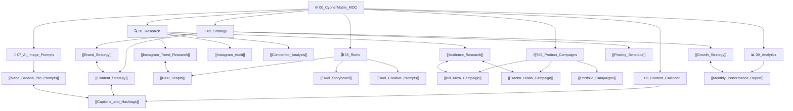

# 🌐 Cypher Matrix: AI-Powered Instagram Growth & Marketing System (MOC)

> **Brand Positioning:** `SECURE. BUILD. SCALE.`  
> **Corporate Entity:** Cyphermatrix Technologies Private Limited (CIN: `U62099PN2024PTC236565`)  
> **Core Category Moat:** *The Software Studio That Builds Bank-Grade Secure Code.*

Welcome to the central **Map of Content (MOC)** for Cypher Matrix's Instagram marketing and B2B growth engine. This hub connects all market intelligence, competitive analysis, brand frameworks, publishing schedules, product campaigns, and creative generation assets.

---

## 🧭 System Architecture & Knowledge Graph

---

## 📚 1. Research Cluster
Foundational market, platform, competitor, and profile investigations:
- [[Instagram_Audit]] — Empirical analysis of [@cyphermatrixpvtltd](https://www.instagram.com/cyphermatrixpvtltd/), bio optimization, handle SEO, and highlight architectures.
- [[Competitor_Analysis]] — Benchmark audit of 10 tech and cybersecurity giants (Appinventiv, MindInventory, Snyk, HackerOne, Cuberto, etc.) and our uncontested "Secure Dev" moat.
- [[Audience_Research]] — Multi-tier buyer personas: International Founders ("Scale-Stage Sam"), Enterprise CTOs ("Architect Alex"), Indian Retailers ("Retailer Rajesh"), and Agritech Operators ("Pradhan Prakash").
- [[Instagram_Trend_Research]] — November 2026 platform mechanics: 20-slide carousels, DM "Sends Per Reach", carousel audio multipliers, and semantic caption SEO.

---

## 📐 2. Strategy Cluster
Core positioning, editorial pillars, timezone schedules, and lead funnels:
- [[Brand_Strategy]] — "Secure. Build. Scale." identity system, obsidian/emerald/crimson color palette, and high-authority voice guidelines.
- [[Typography_and_Layout_Rules]] — Mandatory zero-overflow text boundary constraints, safe-padding laws, and programmatic wrapping checks.
- [[Content_Strategy]] — Rebalanced 6-pillar content distribution (30% Cyber, 25% Dev, 15% Case Studies, 15% Products, 10% Brand, 5% Community).
- [[Posting_Schedule]] — Timezone-synchronized publishing slots (IST, EST, GMT) and 30-day posting velocity testing framework.
- [[Growth_Strategy]] — Organic distribution, collaborative posts, carousel swipe incentives, and human-in-the-loop DM conversion funnels.

---

## 📅 3. Content Calendar & Copywriting
Full editorial schedule and ready-to-publish copywriting:
- [[Captions_and_Hashtags]] — Complete repository of all 30 days of long-form, high-conversion captions, hooks, and targeted 3-5 hashtag sets.
- *Spreadsheet:* `03_Content_Calendar/30_Day_Content_Calendar.xlsx` (Full 15-attribute data grid).

---

## 🎬 4. Reels Production Cluster
Short-form video concepts, scripts, and visual pacing:
- [[Reel_Scripts]] — Complete scripts, scene breakdowns, and voice-over directions (Flutter vs React Native, Mobile Decompilation Exploit, Tractor Hisab Bookkeeping).
- [[Reel_Storyboard]] — Shot-by-shot composition and camera angles.
- [[Reel_Creative_Prompts]] — 9:16 vertical cover prompts for Nano Banana Pro.

---

## 📦 5. Product Campaigns Cluster
Dedicated marketing roadmaps for in-house products and verified enterprise case studies:
- [[Bill_Mitra_Campaign]] — Smart GST invoicing, 4-second Bluetooth thermal printing, and mobile inventory for Indian retail.
- [[Tractor_Hisab_Campaign]] — Agritech plowing (*jotai*) ledger, diesel tracking, and farmer credit bookkeeping.
- [[Portfolio_Campaigns]] — Deep dives into verified deployments: Green Line Distribution (IFFCO Adblue), VeggieKing POS, GLAD AI, and Patnagar Group.

---

## 🎨 6. Real Post Creatives (Full 30-Day Production Library)
Fully generated, production-ready high-resolution visual creative assets, slides, and post briefs (127 images across 30 days):

### 📅 Week 01 (Days 01 – 07)
- **Day 01 (Carousel):** [Day_01_OWASP_Mobile_Top10](file:///Users/cyphermatrix/scratch/CypherMatrix_Instagram_Marketing/04_Post_Creatives/Week_01/Day_01_OWASP_Mobile_Top10/) — (7 Slides, 1080×1350)
- **Day 02 (Reel):** [Day_02_Flutter_vs_ReactNative](file:///Users/cyphermatrix/scratch/CypherMatrix_Instagram_Marketing/04_Post_Creatives/Week_01/Day_02_Flutter_vs_ReactNative/) — (Cover + Telemetry Card, 1080×1920)
- **Day 03 (Product Carousel):** [Day_03_BillMitra_CounterCheckout](file:///Users/cyphermatrix/scratch/CypherMatrix_Instagram_Marketing/04_Post_Creatives/Week_01/Day_03_BillMitra_CounterCheckout/) — (5 Slides, 1080×1080)
- **Day 04 (Case Study):** [Day_04_CaseStudy_GreenLine_Adblue](file:///Users/cyphermatrix/scratch/CypherMatrix_Instagram_Marketing/04_Post_Creatives/Week_01/Day_04_CaseStudy_GreenLine_Adblue/) — (5 Slides, 1080×1350)
- **Day 05 (Infographic):** [Day_05_CypherMatrix_SecureBuildScale](file:///Users/cyphermatrix/scratch/CypherMatrix_Instagram_Marketing/04_Post_Creatives/Week_01/Day_05_CypherMatrix_SecureBuildScale/) — (Single Creative, 1080×1350)
- **Day 06 (Story Sequence):** [Day_06_Founder_Security_Poll](file:///Users/cyphermatrix/scratch/CypherMatrix_Instagram_Marketing/04_Post_Creatives/Week_01/Day_06_Founder_Security_Poll/) — (4 Stories, 1080×1920)
- **Day 07 (Carousel):** [Day_07_API_Security_IDOR](file:///Users/cyphermatrix/scratch/CypherMatrix_Instagram_Marketing/04_Post_Creatives/Week_01/Day_07_API_Security_IDOR/) — (5 Slides, 1080×1350)

### 📅 Week 02 (Days 08 – 14)
- **Day 08 (Carousel):** [Day_08_Offline_First_Architecture](file:///Users/cyphermatrix/scratch/CypherMatrix_Instagram_Marketing/04_Post_Creatives/Week_02/Day_08_Offline_First_Architecture/) — (5 Slides, 1080×1350)
- **Day 09 (Reel):** [Day_09_Tractor_Hisab_Agritech](file:///Users/cyphermatrix/scratch/CypherMatrix_Instagram_Marketing/04_Post_Creatives/Week_02/Day_09_Tractor_Hisab_Agritech/) — (Cover + Telemetry Card, 1080×1920)
- **Day 10 (Case Study):** [Day_10_CaseStudy_VeggieKing_Retail](file:///Users/cyphermatrix/scratch/CypherMatrix_Instagram_Marketing/04_Post_Creatives/Week_02/Day_10_CaseStudy_VeggieKing_Retail/) — (5 Slides, 1080×1350)
- **Day 11 (Carousel):** [Day_11_Mobile_Reverse_Engineering](file:///Users/cyphermatrix/scratch/CypherMatrix_Instagram_Marketing/04_Post_Creatives/Week_02/Day_11_Mobile_Reverse_Engineering/) — (5 Slides, 1080×1350)
- **Day 12 (Creative):** [Day_12_Odoo_Flutter_Library](file:///Users/cyphermatrix/scratch/CypherMatrix_Instagram_Marketing/04_Post_Creatives/Week_02/Day_12_Odoo_Flutter_Library/) — (Single Creative, 1080×1350)
- **Day 13 (Story Sequence):** [Day_13_Flutter_vs_Native_Debate](file:///Users/cyphermatrix/scratch/CypherMatrix_Instagram_Marketing/04_Post_Creatives/Week_02/Day_13_Flutter_vs_Native_Debate/) — (4 Stories, 1080×1920)
- **Day 14 (Carousel):** [Day_14_Cloud_Breach_S3_IAM](file:///Users/cyphermatrix/scratch/CypherMatrix_Instagram_Marketing/04_Post_Creatives/Week_02/Day_14_Cloud_Breach_S3_IAM/) — (5 Slides, 1080×1350)

### 📅 Week 03 (Days 15 – 21)
- **Day 15 (Carousel):** [Day_15_Voice_AI_Mobile_Apps](file:///Users/cyphermatrix/scratch/CypherMatrix_Instagram_Marketing/04_Post_Creatives/Week_03/Day_15_Voice_AI_Mobile_Apps/) — (5 Slides, 1080×1350)
- **Day 16 (Product Carousel):** [Day_16_BillMitra_vs_Desktop_Billing](file:///Users/cyphermatrix/scratch/CypherMatrix_Instagram_Marketing/04_Post_Creatives/Week_03/Day_16_BillMitra_vs_Desktop_Billing/) — (5 Slides, 1080×1080)
- **Day 17 (Case Study):** [Day_17_CaseStudy_GladAI_Workspace](file:///Users/cyphermatrix/scratch/CypherMatrix_Instagram_Marketing/04_Post_Creatives/Week_03/Day_17_CaseStudy_GladAI_Workspace/) — (5 Slides, 1080×1350)
- **Day 18 (Carousel):** [Day_18_Inside_VAPT_Audit](file:///Users/cyphermatrix/scratch/CypherMatrix_Instagram_Marketing/04_Post_Creatives/Week_03/Day_18_Inside_VAPT_Audit/) — (5 Slides, 1080×1350)
- **Day 19 (Founder Advisory):** [Day_19_Cost_of_Cheap_Code](file:///Users/cyphermatrix/scratch/CypherMatrix_Instagram_Marketing/04_Post_Creatives/Week_03/Day_19_Cost_of_Cheap_Code/) — (5 Slides, 1080×1350)
- **Day 20 (Story Sequence):** [Day_20_Cybersecurity_Mythbusters_Quiz](file:///Users/cyphermatrix/scratch/CypherMatrix_Instagram_Marketing/04_Post_Creatives/Week_03/Day_20_Cybersecurity_Mythbusters_Quiz/) — (4 Stories, 1080×1920)
- **Day 21 (Technical Carousel):** [Day_21_Certificate_Pinning_Code](file:///Users/cyphermatrix/scratch/CypherMatrix_Instagram_Marketing/04_Post_Creatives/Week_03/Day_21_Certificate_Pinning_Code/) — (5 Slides, 1080×1350)

### 📅 Week 04 (Days 22 – 30)
- **Day 22 (Carousel):** [Day_22_Flutter_StateManagement_Riverpod_Bloc](file:///Users/cyphermatrix/scratch/CypherMatrix_Instagram_Marketing/04_Post_Creatives/Week_04/Day_22_Flutter_StateManagement_Riverpod_Bloc/) — (5 Slides, 1080×1350)
- **Day 23 (Product Carousel):** [Day_23_BillMitra_Inventory_Stock](file:///Users/cyphermatrix/scratch/CypherMatrix_Instagram_Marketing/04_Post_Creatives/Week_04/Day_23_BillMitra_Inventory_Stock/) — (5 Slides, 1080×1080)
- **Day 24 (Case Study):** [Day_24_CaseStudy_Patnagar_Organic](file:///Users/cyphermatrix/scratch/CypherMatrix_Instagram_Marketing/04_Post_Creatives/Week_04/Day_24_CaseStudy_Patnagar_Organic/) — (5 Slides, 1080×1350)
- **Day 25 (Carousel):** [Day_25_Modern_SQL_Injection](file:///Users/cyphermatrix/scratch/CypherMatrix_Instagram_Marketing/04_Post_Creatives/Week_04/Day_25_Modern_SQL_Injection/) — (5 Slides, 1080×1350)
- **Day 26 (Creative):** [Day_26_Behind_The_Sprints_Hub](file:///Users/cyphermatrix/scratch/CypherMatrix_Instagram_Marketing/04_Post_Creatives/Week_04/Day_26_Behind_The_Sprints_Hub/) — (Single Creative, 1080×1350)
- **Day 27 (Story Sequence):** [Day_27_DevSecOps_Quiz](file:///Users/cyphermatrix/scratch/CypherMatrix_Instagram_Marketing/04_Post_Creatives/Week_04/Day_27_DevSecOps_Quiz/) — (4 Stories, 1080×1920)
- **Day 28 (Technical Carousel):** [Day_28_PreLaunch_Security_Checklist](file:///Users/cyphermatrix/scratch/CypherMatrix_Instagram_Marketing/04_Post_Creatives/Week_04/Day_28_PreLaunch_Security_Checklist/) — (5 Slides, 1080×1350)
- **Day 29 (Carousel):** [Day_29_Microservices_vs_ModularMonolith](file:///Users/cyphermatrix/scratch/CypherMatrix_Instagram_Marketing/04_Post_Creatives/Week_04/Day_29_Microservices_vs_ModularMonolith/) — (5 Slides, 1080×1350)
- **Day 30 (Reel):** [Day_30_TractorHisab_Season_Audit](file:///Users/cyphermatrix/scratch/CypherMatrix_Instagram_Marketing/04_Post_Creatives/Week_04/Day_30_TractorHisab_Season_Audit/) — (Cover + Telemetry Card, 1080×1920)

---

## 🤖 7. AI Creative Engine
High-fidelity visual prompt architecture:
- [[Nano_Banana_Pro_Prompts]] — Master Google Nano Banana Pro prompts, Octane 3D dark-mode styling, and resolution configurations (4:5 / 1:1 / 9:16).

---

## 📊 8. Analytics & Feedback Loop
Performance tracking and optimization cycles:
- [[Monthly_Performance_Report]] — 30-day KPI scorecard, reach variance, and weekly 7-day iteration protocol.
- *Spreadsheet:* `09_Analytics/Weekly_Performance.xlsx` (Weekly tracking table).

---

## 🔗 Master Vault Connections
- **Vault Root:** [[my brain]]
- **Tags:** #cyphermatrix #marketing #instagram #cybersecurity #vapt #flutter #b2b #growth
